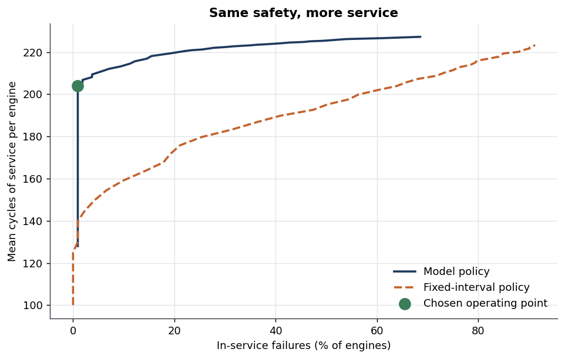
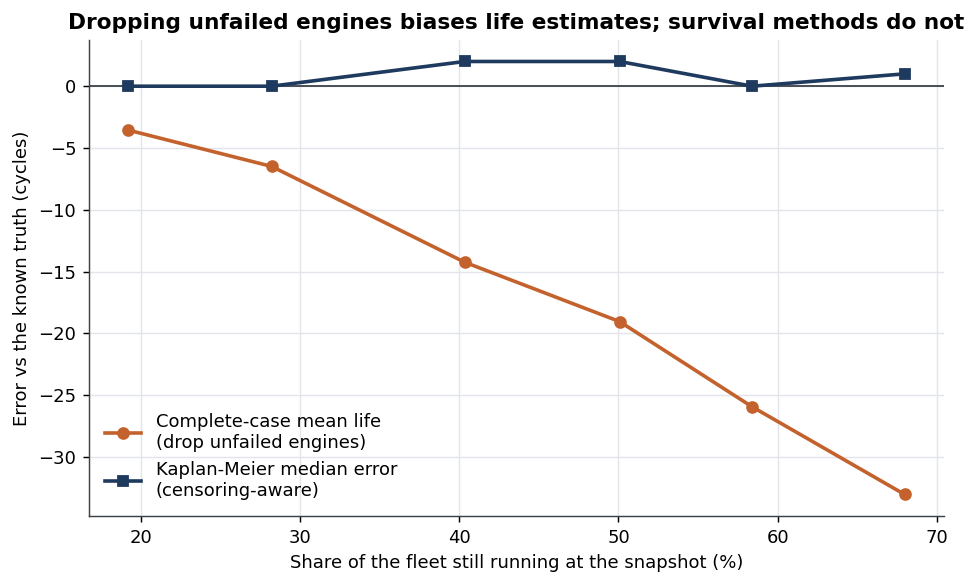
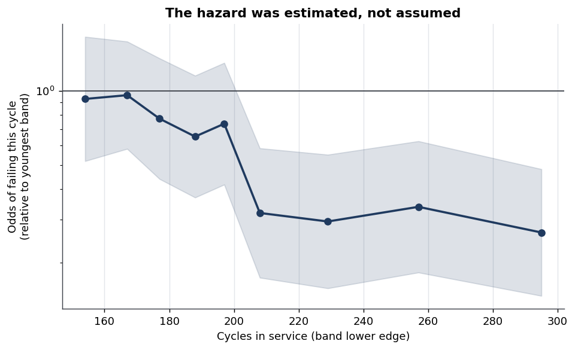
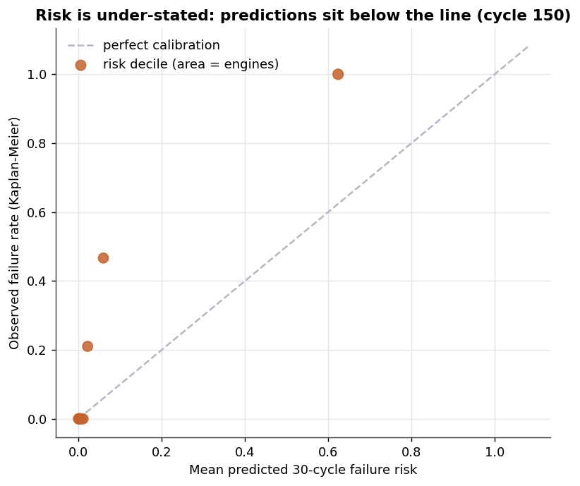

# Turbofan Maintenance Timing

**A condition-based pull rule costs 31% less than the best possible fixed-interval schedule,
at exactly the same 0.9% failure rate — same safety, 46% more working life.**

**When should you pull a machine out of service?**

A censoring-aware survival analysis of 709 industrial units, turned into a maintenance
threshold you can act on. Python, statsmodels, lifelines, scikit-survival, pytest —
49 tests, reproducible end to end from a clean checkout in about 20 seconds.

*Data: NASA C-MAPSS turbofan degradation benchmark (public domain). It is simulator
output, not a real fleet, and it is used as a stated analogue for industrial
maintenance-timing problems — see [Data and licence](#data-and-licence).*

---

## The finding

**A condition-based pull rule costs 31% less than the best possible fixed-interval
schedule — at exactly the same failure rate.**

| Policy | Cost per 1,000 cycles of service | In-service failures | Service delivered per unit |
|---|--:|--:|--:|
| Run to failure | 21.87 | 100% | 229 cycles |
| Best fixed interval (every 140 cycles) | 7.42 | 0.9% | 140 cycles |
| **Model policy (pull at 7.7% 30-cycle risk)** | **5.09** | **0.9%** | **204 cycles** |

Saving vs the best fixed interval: **31.4%** (95% CI 28.0–34.3%, bootstrapped over units).

The intuition is in the last column, and it is worth stating in plain terms: the calendar
policy and the model policy accept **the same 0.9% failure rate**, but the calendar has to
pull every unit at 140 cycles to get there, while the model pulls each unit when *that unit*
looks unwell — at 204 cycles on average. **Same safety, 46% more working life.**

The alarm gives a **median 25 cycles of warning**, with the slowest 10% of cases giving 12.
That is the number that decides whether any of this is operationally usable, and it is
reported for that reason.



The finding is robust to the one input this analysis does not know: the ratio of failure
cost to planned-removal cost. Swept from 2× to 20×, the saving stays between 28% and 31%,
and the recommended threshold barely moves.

---

## The methodological finding, which matters more

**Almost every published analysis of this benchmark quietly assumes you can see every
machine fail. You cannot, and the assumption costs you.**

The standard framing is "predict remaining useful life" — regress cycles-to-failure on
the sensors, report RMSE. That needs a completed lifetime as the training target. But at
any moment a real fleet is *mostly machines that have not failed yet*, and those are
precisely the machines a maintenance decision is about. A method that can only learn from
completed lifetimes has to throw them away.

Throwing them away is not merely wasteful. It is **biased, in a knowable direction**: a
unit is missing its failure exactly when its lifetime ran past the observation window, so
deleting unfailed units deletes the long-lived ones preferentially. The fleet then looks
more fragile than it is.

This project measures that, because it can. The raw benchmark contains complete
run-to-failure trajectories, so the analysis **censors them on purpose** — each unit is
watched only up to a snapshot horizon drawn independently of its lifetime — and then
compares three estimates against a truth that is actually known:

| Estimate of mean life | Cycles | Error |
|---|--:|--:|
| Truth (full trajectories) | 226.2 | — |
| Complete-case (drop unfailed units) | 211.9 | **−14.2 (−6.3%)** |
| Naive (count the snapshot as the lifetime) | 179.0 | **−47.2 (−20.9%)** |
| Kaplan-Meier median vs true median | 209 vs 207 | **+2 cycles** |

And the bias is not an artefact of one setting. It grows monotonically with how much of
the fleet is still running — which is the direction that matters, because real fleets are
mostly survivors:



The second series is the positive half of the argument, and it is why the project has a
recommendation rather than just a complaint: **the information is not destroyed by
censoring, only by the wrong estimator.** Kaplan-Meier's error stays on zero across the
whole sweep.

---

## Three more things the analysis found

### Change from the unit's own baseline beats the raw sensor level

Machines enter service with different, unstated amounts of initial wear. A sensor's
*level* therefore confounds "born worn" with "worn out"; the change since that unit's own
first few cycles separates them. That is an argument, so it was tested rather than
asserted:

| Feature set | Parameters | In-sample pseudo-R² | Holdout Harrell's C | Holdout Uno's C |
|---|--:|--:|--:|--:|
| **Drift from own baseline** | 27 | 0.397 | **0.895** | **0.881** |
| Sensor level | 27 | 0.590 | 0.854 | 0.831 |
| Both | 44 | 0.599 | 0.860 | 0.836 |

The level features fit *much* better in sample and discriminate *worse* out of it. That is
what overfitting looks like, and it is why the model uses drift alone.

### Cox's assumption fails on exactly the sensors that matter

Proportional hazards was tested with Schoenfeld residuals, not inherited: **10 of 17
covariates violate it** after Holm correction for multiple testing. The violations are
concentrated in the highest-effect sensors (4, 11, 2, 3, 17) — their influence *weakens*
as a unit ages. That is the sharpest possible argument for the discrete-time model used
here, whose baseline hazard is free to take any shape.



### The textbook threshold formula is wrong here, and it is wrong by 22%

For a well-calibrated model the cost-optimal alarm threshold is analytic: act when
`c_pull / c_fail`. This model is **not** well calibrated — it understates risk badly in the
top deciles, because `horizon_risk` freezes the sensor readings at their current value and
a fast-degrading unit therefore has its future understated.



Rather than leave that as an unquantified caveat, it is measured: setting the threshold by
the textbook formula would cost **21.9% more** and accept an **8.0% failure rate instead of
0.9%**. The project's response is to stop relying on the probabilities being right — the
threshold is *swept* and chosen by measured cost, which only requires the model to rank
units correctly. It does: Uno's C is 0.88.

---

## How it works

Four models, laid out as a ladder, each rung justifying the next:

1. **Kaplan-Meier + log-rank** — no covariates, no functional form. Establishes that the
   four fleet designs really do differ (χ² = 44.4, p = 1.3e-09) *before* any model assumes
   it.
2. **Cox PH with time-varying covariates** — the reflex choice, fitted so that its central
   assumption can be tested rather than inherited. It fails (above).
3. **Discrete-time logistic hazard** — the workhorse. Units are inspected once per cycle
   and either fail or do not, which is a Bernoulli trial per cycle at risk; a logistic
   regression on the risk set estimates the per-cycle probability directly. Standard errors
   clustered by unit, because one machine contributes hundreds of correlated rows.
4. **Random Survival Forest** — a comparator, to bound what the interpretable model gives
   up.

Two decisions the data forced, both worth knowing about:

- **The hazard bands are equal-*event*, not equal-width.** Equal-width bands in the sparse
  tail contain no failures at all, and a zero-event band has a coefficient of minus
  infinity — the fit does not converge and the Hessian is singular.
- **The analysis is conditional on surviving to cycle 128.** No unit in this fleet fails
  before then, so those ~40,000 early rows have a constant outcome and drive the intercept
  to minus infinity. Restricting the risk set is delayed entry (left truncation) at a fixed
  landmark, and it is stated as a modelling decision rather than buried: the model says
  nothing about the first 127 cycles, and it should not.

Scoring is done at **landmarks** — fix a cycle, keep the units still running, use their
readings at that instant, and score how well the predicted risk orders what happens next.
A time-varying-covariate model does not have one C-index; it has one per moment at which
you might ask.

| Landmark cycle | Units at risk | Failures | Harrell's C | Uno's C |
|--:|--:|--:|--:|--:|
| 150 | 153 | 120 | 0.883 | 0.864 |
| 175 | 119 | 96 | 0.899 | 0.889 |
| 200 | 88 | 69 | 0.904 | 0.892 |

Both indices are reported deliberately. Harrell's C is biased under censoring; Uno's C
reweights by the inverse probability of remaining uncensored and is not. In a project whose
subject is censoring, quoting only the censoring-sensitive metric would be self-defeating.

Integrated Brier score **0.122** against a Kaplan-Meier baseline of **0.158** — the model
beats the curve that uses no sensor information at all, which is the reference every
prognostic model should have to clear.

---

## Reproducing this

```bash
py -3.10 -m venv .venv && .venv/Scripts/pip install -r requirements.txt
```
```bash
python src/acquisition.py
```
```bash
python -m pytest -q
```
```bash
python run_analysis.py
```

`src/acquisition.py` downloads the benchmark, tries three known mirrors in order, records
which one served, and checksums every extracted file into `data/raw/provenance.json`. It
asserts the published unit counts, so a repackaged mirror fails loudly instead of quietly
shrinking the fleet.

`run_analysis.py` regenerates **every** number in this README and every figure in
`outputs/figures/`, in about 20 seconds. No number here exists only in a notebook cell.
The capstone notebook imports `src/` and calls the same functions, so the notebook and the
script cannot disagree.

## How it is built

```
src/acquisition.py   download, verify, parse, record provenance
src/panel.py         regimes, features, the censoring mechanism, the risk set
src/survival.py      the four models, hazard bands, forward risk, PH test
src/evaluate.py      concordance, AUC, Brier, calibration, the censoring critique
src/policy.py        cost model, threshold sweep, baselines, bootstrap
src/figures.py       every published figure
run_analysis.py      regenerates all results and figures
tests/               49 tests
notebooks/           00_ capstone (start here) + 01-04 staged working notebooks
learning/            the concept series
src-explained/       one walkthrough per src/ module
```

Two panels exist and the separation between them is load-bearing:
`risk_set` is truncated at the snapshot and is the **only** thing any model is fitted on;
`evaluation_panel` holds the complete trajectories and is used **only** to simulate what a
policy would have cost. Being able to build the second one at all is the reason a simulator
benchmark is worth using here — on a real fleet the counterfactual is unobservable, and a
policy can only be argued for, never measured.

---

## Limitations

- **The data is simulated.** C-MAPSS is physics-model output with injected noise, not
  measurements from a real fleet. Nothing here is a claim about real turbofans. The
  *methods* transfer; the specific numbers do not.
- **Censoring is induced by design, not observed.** The mechanism is administrative and
  independent of lifetime by construction. Real maintenance data often has **informative**
  censoring — units pulled *because* they looked unwell — which breaks both Kaplan-Meier
  and the partial likelihood. That case is out of scope here and would need a different
  approach.
- **The model is not well calibrated.** It understates risk in the top deciles, for the
  known reason given above. The decision layer is designed around this rather than
  pretending otherwise, and the cost of ignoring it is quantified at 21.9%.
- **Forward risk freezes the covariates.** A unit degrading unusually fast has its future
  understated, which makes the reported policy gain conservative rather than flattering.
- **Costs are relative, not currency.** A planned removal is 1 and a failure is the
  multiple; no monetary figure is claimed. The sensitivity sweep is what makes the
  recommendation usable without one.
- **The analysis says nothing before cycle 128**, by construction, and 106 fit-set units
  censored before that window drop out of the model fit entirely.

## Data and licence

Saxena, A. and Goebel, K. (2008). *Turbofan Engine Degradation Simulation Data Set*.
NASA Prognostics Data Repository, NASA Ames Research Center, Moffett Field, CA.
[PCoE data set repository](https://www.nasa.gov/intelligent-systems-division/discovery-and-systems-health/pcoe/pcoe-data-set-repository/)

Work of the U.S. Government — public domain. 709 training units across four
operating-condition and fault-mode designs; 160,359 unit-cycles; 21 sensors and 3
operational settings per cycle. The data is downloaded at runtime rather than committed,
so the provenance record describes the bytes actually analysed.

This project is not affiliated with, and uses no data from, any employer. C-MAPSS is used
as a public stand-in for the class of problem, and no proprietary data is involved.

Code: MIT (see `LICENSE`).
